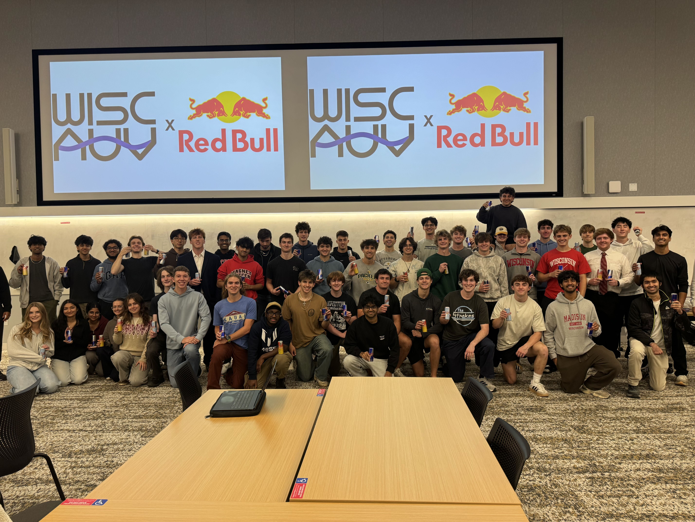

Yesterday, our business director, Chase Metzger, announced that we had officially secured a sponsorship with Red Bull. For us, this means an unlimited supply of Red Bull in our lab in the basement of the mechanical engineering building. However, it symbolizes a lot more than that. 

Looking at the photo above, I see a very large and growing team of many talented, dedicated, and hardworking individuals. Considering that, just under a year ago, WAUV had just been formed, one would be amazed to see its growth. Sponsorships like these serve as an indication of the excitement around what we're building, as well as the expectations we have to live up to. Opportunities like this are what drive me to show up and dedicate hours of time to working on the projects we're building.
