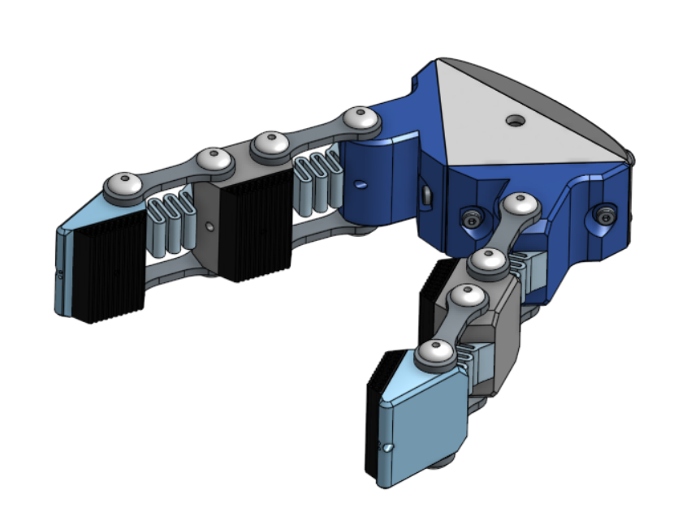

Wisconsin Autonomous Underwater Vehicles (WAUV) is a brand new engineering club at UW-Madison. We will be competing in the [RoboSub](https://robosub.org/programs/2027/) competition this coming summer in Irvine, California.

During the competition, our fully autonomous submarine must complete [six tasks](https://robonation.gitbook.io/robosub-resources/section-3-autonomy-challenge/3.2-task-descriptions) to earn the highest score. Tasks 3, 4, and 5 require mechanical apparatuses. As mechanisms lead, my job is to not only design them myself, but guide the design, prototyping, testing, and integration of all of these mechanisms. I'll go over each task and their respective mechanism projects in more detail below:

**Task 3 (Recon):**
The _Recon_ task requires the AUV to drop markers in the correct bin based on a role assigned at the beginning of the competition. Competitors are allowed two markers, typically small steel balls, and must accurately place both markers in the correct bins. The AUV will obtain points for placing up to two markers in the correct bin, and extra points if they place them in both correct bins, meaning one in each bin, rather than two markers in one of the bins.

From a mechanisms perspective, this task is the easiest. We create a dropper that utilizes either a servo or solenoid to hold both markers inside, and drop them one-by-one on command. The droppers, therefore, aren't very mechanically complicated, and should focus on reliability and small form factor.

**Task 4 (Deploy):**
The _Deploy_ task requires the AUV to fire some form of torpedo/projectile through openings on a target board. Full points are awarded only if the torpedo travels fully through the correct opening, once again determined by a pre-assigned role. Extra points are earned for firing from a further distance, testing accuracy.

The torpedo launcher mechanism is a great mechanical challenge. Teams are allowed up to two torpedoes, and due to the nature of the competition, they must be pre-loaded at the beginning of a run. Our current design for this mechanism uses bungee cords to pull on the torpedo, and solenoids to hold it in until we want to fire it. This project combines both mechanical design challenge with dynamics analysis to ensure accurate torpedoes.

**Task 5 (Restore):**
The _Restore_ task requires the AUV to identify and pick up objects, surface with them within a specific area (surfacing anywhere else during the competition results in immediate disqualification for that run), and then place them in their correct basket. This task is historically the most difficult for teams to complete. One of the most challenging things about this task is that the objects to be picked up are different each year, and are not announced until very close to the competition.

Mechanically, this keeps us on our toes. The gripper mechanism must not only be designed with the broadest variety of object grabbing capabilities in mind, but it must still be reliable and simple, to ensure that no mechanical failures can kill a run. There are many different approaches to this problem. Some teams utilize full 6-DOF robot arms, while many opt for a simpler, horizontally grasping gripper mechanism. Our team's approach is to design many different mechanisms, so we can decide at competition which to use and easily hot-swap them in for one another. Every one of our designs is actuated by one singular stepper motor, so our designs are limited only by that.

Over the last semester, I've worked on my own design for the gripper mechanism.

This design features some key elements that make it very unique. 

First of all, the stepper motor spins pulleys to apply a tensile load to tendon cables running through the inside of each of the two fingers. This tensile load causes the fingers to close up in a curling motion, allowing for dynamic wrapping around of any shape of object.

The zig-zag shaped springs apply a reaction torque to each of the finger joints, causing it to naturally stay opened when the stepper is not actuating the tendons. This effectively causes an on/off motion in a system that has no physical stops.

TPU finger pads are screwed into each of the gripping surfaces to ensure a good grip under the water, and they can deform to whatever shape is being grasped.

The linkages between each finger joint prevent deflection forward and backward, causing the springs to only allow the curling motion and preventing fracture during use.
